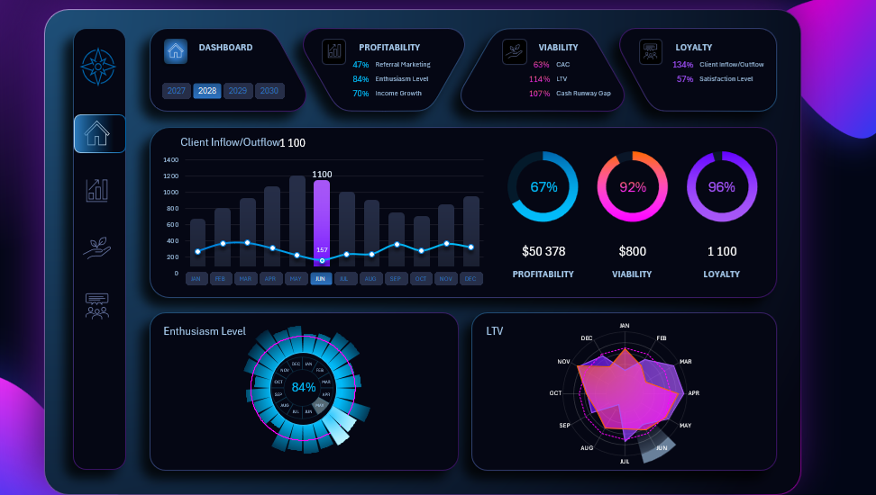
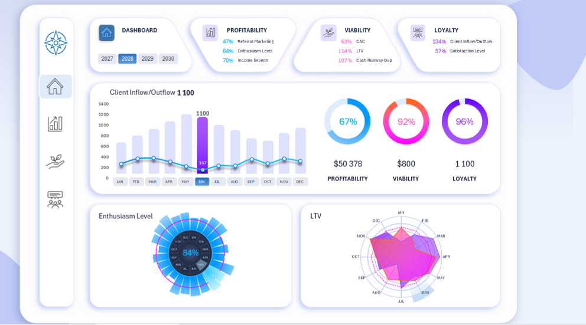
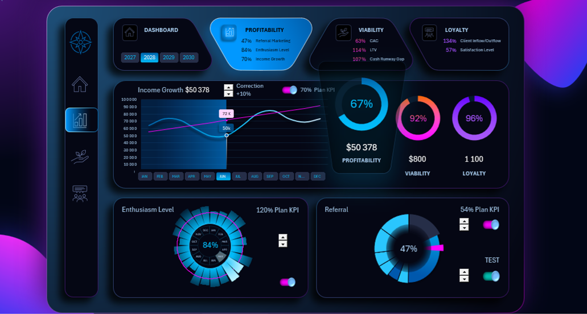
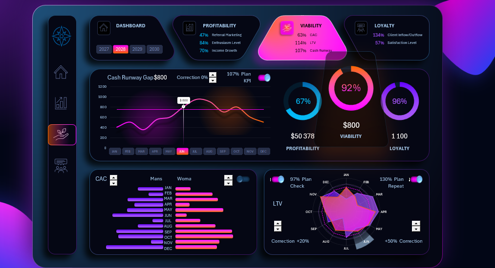
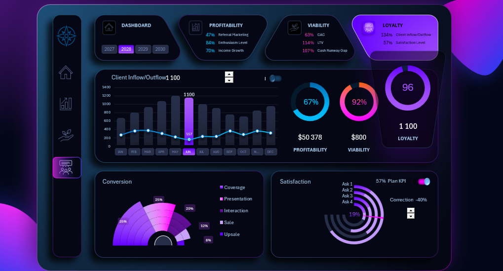

# Profitability · Viability · Loyalty — Interactive Excel KPI Dashboard

> A business health dashboard built entirely in Excel: no VBA, no add-ins. It's just formulas, pivot tables, form controls and about 150 charts working together.




## Why I built this

During my Finance master's I kept running into the same problem. The numbers that say whether a business is healthy are spread across separate reports: revenue in one place, cash in another, customer feedback somewhere else. I wanted to see what it takes to put all of it on one screen so that a manager can answer three questions in about ten seconds:

1. **Is the business making money?** → *Profitability*
2. **Can it keep going?** → *Viability*
3. **Do customers want to come back?** → *Loyalty*

I also gave myself a constraint: do it in plain Excel. Most companies already have Excel. If I can build something interactive and good-looking with nothing else, I can build it anywhere, and I'll understand every number behind it.

---

## What's inside

| Sheet | What it shows |
|---|---|
| **DASHBOARD** | Executive overview with one score gauge for each pillar (Profitability, Viability, Loyalty) and the headline KPIs |
| **PROFITABILITY** | Income growth vs. plan, LTV, CAC, plan correction scenarios |
| **VIABILITY** | Cash runway gap vs. plan level, client inflow/outflow, customer split, average check and repeat-purchase frequency vs. plan |
| **LOYALTY** | Satisfaction levels across four survey questions (active vs. passive answers), the sales funnel (coverage → presentation → interaction → sale → upsale), referral marketing |
| **Light versions** | Every page also comes in a light theme for printing and presenting |
| Data · Control · Processing | The engine room (see below) |

**Dataset:** 48 months of monthly data (2027–2030), 30 business metrics per month. <!-- edit: say whether the data is synthetic/sample or anonymised real data -->

---

## How it works

I built the workbook in layers, the way you'd structure a small data pipeline:

```
Data (structured table "mydata")
   ↓
Control (3 pivot tables + Year/Month slicers)
   ↓
Processing (calculation layer: GETPIVOTDATA, INDEX, dynamic ranges, KPI scores)
   ↓
Dashboard pages (charts reading only from Processing)
```

- **One source of truth.** All raw data sits in a single Excel Table. Add a new month and everything updates.
- **Slicers drive everything.** Pick a year or a month and all four pages recalculate through the pivot cache.
- **The charts hold no logic.** Every calculation happens in the Processing sheet, and charts only display results. That keeps the model auditable, and when a number looks wrong I know exactly where to look.
- **Composite KPI scores.** Each pillar gets one score that averages its KPIs against plan (for example, Viability combines cash runway, average check and repeat frequency). The gauges then show at a glance whether you're over or under target.

### Interactivity without code
- **~20 checkboxes** turn KPI overlays and plan lines on and off
- **~20 spin buttons** apply plan corrections (for example −40% … +50%) and step through scenarios, so you can see what happens if the plan changes
- **Scenario / iteration table** for testing how results respond over successive cycles
- **Dynamic labels** built with `TEXT()` and `IF()`, so chart annotations like *"107% Plan KPI"* always match the current selection
- **Custom number formats** (e.g. `[>=1000]0,"k"`) keep the visuals clean

---

## What this project shows about how I work

- **Financial thinking:** I chose metrics that answer real management questions (unit economics with LTV/CAC, liquidity with cash runway, retention with repeat frequency and satisfaction), not just whatever was easy to chart.
- **Model structure:** separate input, calculation and output layers, the same discipline I'd use in a financial model or a Python project.
- **Advanced Excel:** pivot tables and slicers, GETPIVOTDATA, array formulas, form controls, dynamic chart ranges, conditional labelling.
- **Design sense:** a dark/light theme system, a consistent colour palette, and layouts built for a quick read in a meeting.
- **Patience with detail.** About 150 charts that all stay in sync took a lot of it 🙂

---

## How to use it

1. Download `profitability_viability_loyalty_dashboard.xlsx`
2. Open it in **Microsoft Excel 365 / 2019+** on desktop (slicers and form controls don't fully work in Excel Online or Google Sheets)
3. Start on **DASHBOARD**, choose a Year/Month with the slicers, then drill into each pillar
4. Use the checkboxes and spin buttons to switch KPIs and test plan corrections

---

## What's next

This is my "foundation" version. Next, I'd like to:
- [ ] Rebuild the data layer in **SQL** and connect it with Power Query
- [ ] Recreate the dashboard in **Tableau** and compare the two approaches
- [ ] Add a **Python** script that generates/forecasts the monthly data (e.g. an income growth forecast with confidence bands)

---

## More images








